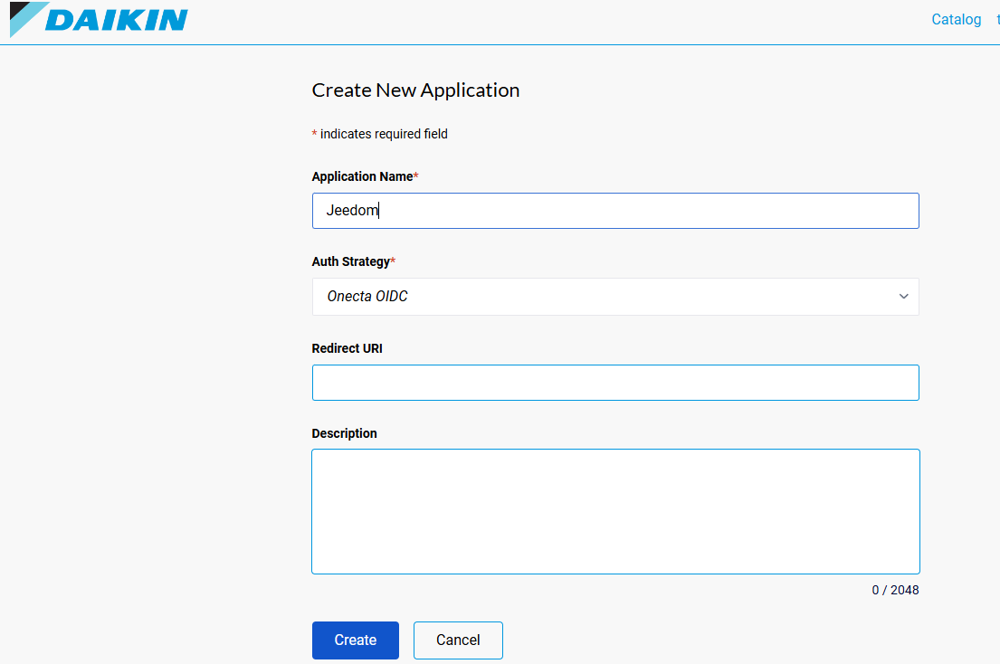
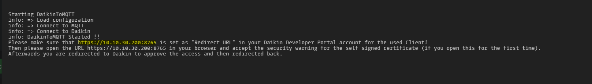
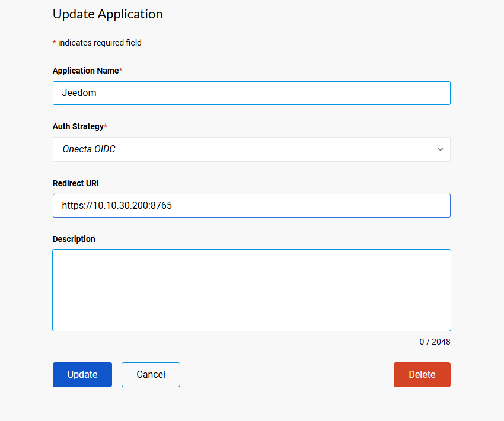
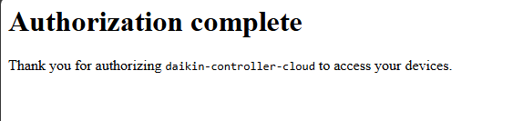

# Autenticación

Para que Jeedom pueda controlar sus dispositivos Daikin, el plugin debe conectarse a su cuenta en la nube Daikin ONECTA. Hay dos modos de conexión disponibles.

## ¿Qué modo elegir?

**Developer Portal** es el modo de funcionamiento **oficial** propuesto por Daikin (API pública del portal de desarrolladores).

**Mobile App** **no está soportado oficialmente** por Daikin. Se basa en una API no pública dedicada a la aplicación móvil oficial: este modo puede **dejar de funcionar en cualquier momento** sin aviso.

| | Developer Portal (recomendado) | Mobile App |
|---|-------------------------------|------------|
| **Estado** | Oficial Daikin | No oficial — puede romperse en cualquier momento |
| **Credenciales** | Client ID + Client Secret | Email + contraseña Onecta |
| **¿Misma cuenta que la app móvil?** | No (cuenta de desarrollador separada) | Sí |
| **Cuota diaria** | 200 consultas | 3000 consultas |
| **Actualizaciones en tiempo real** | No | Sí |
| **Configuración** | Procedimiento OAuth | Simple (2 campos) |

---

## Modo Developer Portal

Este modo utiliza una aplicación creada en el [portal de desarrolladores Daikin](https://developer.cloud.daikineurope.com/). Es el funcionamiento **oficial** de Daikin. Cuota: 200 consultas/día. Se requiere el procedimiento OAuth para la primera conexión.

### Configuración inicial

1. Abra **Plugins → Daikin ONECTA → Configuración**.
2. Seleccione **Developer Portal (OAuth)**.
3. Introduzca el **Client ID** y el **Client Secret** de su aplicación.
4. Haga clic en **Guardar**.

### Tutorial de primera conexión

#### Paso 1: Crear una cuenta de desarrollador

Vaya a [developer.cloud.daikineurope.com](https://developer.cloud.daikineurope.com/) e inicie sesión.

#### Paso 2: Acceder a sus aplicaciones

Haga clic en su dirección de email arriba a la derecha, luego elija **My Apps**.

#### Paso 3: Crear una aplicación

Haga clic en **New App**, asígnela un nombre (p. ej. «Jeedom»), seleccione **Onecta OIDC** como *Auth Strategy* y valide.

#### Paso 4: Copiar las credenciales

Copie el **Client ID** y el **Client Secret** en la configuración del plugin, luego guarde.

#### Paso 5: Iniciar el plugin y recuperar la URL

1. Inicie el servicio del plugin.
2. Abra los **logs** del plugin (**Análisis → Logs**, filtro `daikinRCCloud`).
3. Copie la **URL de autenticación** mostrada en los logs (p. ej. `https://IP_JEEDOM:8765`).

#### Paso 6: Configurar la URL de redirección

1. Vuelva al portal de desarrolladores Daikin.
2. Edite su aplicación.
3. Pegue la URL copiada en el campo **Redirect URI**.
4. Haga clic en **Update**.

#### Paso 7: Autorizar el acceso

1. Abra la URL de autenticación en un navegador.
2. Acepte el certificado si su navegador lo muestra.
3. Siga el procedimiento de autorización Daikin.

#### Paso 8: Verificar

Un mensaje de éxito confirma que la conexión está establecida. Sus dispositivos deberían aparecer en Jeedom.

### En caso de problema

- Si Daikin invalida su clave API, reinicie el procedimiento de conexión desde el paso 5.
- Compruebe que el puerto de autenticación (predeterminado: 8765) no está bloqueado por un cortafuegos.
- Consulte el [tutorial en la comunidad Jeedom](https://community.jeedom.com/t/onecta-cloud-api-key-invalidation-action-required/127311/33?u=thibaut_t) en caso de invalidación de clave.

---

## Modo Mobile App

> **Atención:** este modo **no está soportado oficialmente** por Daikin. Se basa en una API no pública dedicada a la app Onecta y puede **dejar de funcionar en cualquier momento**. Prefiera el [modo Developer Portal](#modo-developer-portal) para un uso duradero.

Este modo utiliza la misma cuenta que la aplicación **Daikin Onecta** o **Daikin Residential Controller** en su teléfono.

### Configuración

1. Abra **Plugins → Daikin ONECTA → Configuración**.
2. Seleccione **Mobile App**.
3. Introduzca su **email Onecta**.
4. Introduzca su **contraseña Onecta**.
5. Haga clic en **Guardar**.
6. Inicie o reinicie el servicio del plugin.

### Funcionamiento

- La conexión se realiza automáticamente al iniciar el plugin.
- Su contraseña se almacena de forma segura en Jeedom.
- Las actualizaciones en tiempo real están activadas por defecto, lo que hace el plugin muy reactivo sin consumir mucha cuota.

### En caso de problema

- Compruebe que puede conectarse a la aplicación Daikin Onecta en su teléfono con las mismas credenciales.
- Si ha cambiado su contraseña Onecta, actualícela en la configuración del plugin.
- Reinicie el servicio del plugin tras cualquier modificación.

---

[Anterior: Configuración]({{ site.baseurl }}/es_ES/configuration.html) — [Siguiente: Uso]({{ site.baseurl }}/es_ES/utilisation.html)
